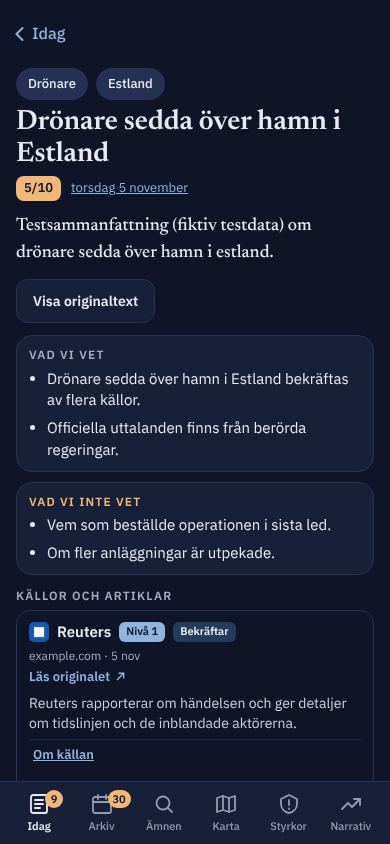

# Granskning 2: webbappen Hotmonitor inför lansering

*Granskad 5 november 2026, gren `oversyn-appen`, utgångspunkt `main` vid e44c4b5 (hm-v3.35).
Ingen kod är ändrad. Pilen bakåt som en annan session lägger till är inte granskad.*

**Metod.** Jag har läst `webapp/src/worker.js`, `webapp/public/` (app.js, api.js, sw.js, app.css,
index.html, features.js, _headers, manifest), CONTRACT.md och DEPLOY.md. Jag körde appen lokalt med
`webapp/dev/mock_server.py` (MOCK_ROLE=guest och admin) på 30 fiktiva testrapporter, som jag skapade i
`reports/` (gitignorerad, inte committad). Med Playwright tog jag skärmbilder i 390 px bredd i ljust och
mörkt läge, räknade nätverksanrop, mätte laddtid på ett strypt mobilnät och körde axe-core
(WCAG 2.2 A/AA) på sju vyer. Skärmbilderna ligger i `docs/review/img/`.

**Begränsningar.** Mockservern svarar 404 på `/api/trends`, `/api/authorities` och `/api/courses`.
Narrativ visar därför ett felläge lokalt, och myndighets- och scenarioblocken på Idag syns inte.
Testrapporterna är små, så de verkliga rapporterna gör laddtiderna längre än de jag mätte.

Insats: **S** = timmar, **M** = 1–3 dagar, **L** = en vecka eller mer.

---

## Sammanfattning: de fem viktigaste fynden

1. **Ett första besök på Idag gör ett API-anrop per rapport som någonsin publicerats.**
   `viewReport` anropar `loadAllReports()` (app.js:671, api.js:140). Med 30 testrapporter blev det
   47 API-anrop. Med de omkring 48 rapporter som finns i dag (sedan 19 sep) blir det omkring 65, och
   antalet växer med en per dag. DEPLOY.md:416 räknar med 6–10 anrop per besök. Gratisnivåns
   100 000 Worker-anrop räcker alltså till ungefär **1 500 förstabesök per dygn**, inte 10 000. När
   gränsen nås får alla fel 1027 till midnatt UTC, även administratörer, och även Macens och
   GitHub Actions uppladdning av morgonrapporten (samma Worker). Det här är det viktigaste att fixa
   före lansering. Se avsnitt 3.
2. **En enda IP-adress kan förbruka hela dygnets kvot**, även utan att bryta mot rate limit.
   Gästgränsen är 600 anrop per minut och IP-adress, räknad per isolate (worker.js:43, 1986). Det blir
   100 000 anrop på under tre timmar. Anrop som får 429 räknas också som Worker-anrop. Bot-skydd behövs
   före Workern (egen domän och WAF), eller Workers Paid.
3. **AI-märkningen finns bara på sidan Om** (app.js:3658). EU:s AI-förordning art. 50.4 gäller sedan
   2 augusti 2026. Den kräver att AI-genererad text som publiceras för att informera allmänheten om
   frågor av allmänt intresse märks där den visas, om ingen människa granskar texten redaktionellt och
   bär ansvaret för den. Idag och händelsesidorna saknar märkning.
4. **En ny läsare får ingen förklaring av siffrorna.** ”5,0 /10” och ”30 DAGAR · Prognos” står utan
   förklaring (app.js:819–825). Händelsernas färgade ruta med ”5” eller ”9,1” är *trovärdighet*, men
   ingenting i bild säger det. Etiketten finns bara i en aria-label på en `span` (app.js:889), och den
   läses inte alltid upp. Färgen (orange eller mörkblå) ser ut som allvarlighetsgrad.
5. **Säkerheten mot XSS är god, och gästläget är genomtänkt.** All rendering går via `textContent` och
   `createElement`. Funktionen `h()` (app.js:40) skapar aldrig HTML. CSP tillåter bara skript från
   `'self'`. Externa länkar kontrolleras (http/https) och visas bakom en varning. E-postadresser byts
   mot pseudonymer. Det som återstår här är främst integritet (Google Fonts, integritetstext för
   inloggade) och skydd mot överbelastning.

---

## 1. Användbarhet för en ny, oinloggad läsare

  

### 1.1 Förstår man vad appen är?

| # | Fynd | Var | Förslag | Insats |
|---|---|---|---|---|
| U1 | Förstasidan säger inte vad Hotmonitor är. Rubriken är ”Hotläget”, och beskrivningen finns bara i `<meta name="description">` och under länken ”Om”. | index.html:7, app.js:692–702 | Lägg en rad under rubriken för gäster: *”Daglig AI-sammanställning av ryska hybridhot mot Nato, EU och Ukraina, ur öppna källor. Privat projekt, inte en myndighet.”* Visa den för gäster och vid första besöket, och gör den möjlig att stänga (localStorage). | S |
| U2 | Det framgår inte vad hotindex betyder. ”5,0 /10” saknar skalförklaring, och ”30 DAGAR · Prognos” kan läsas som ”senaste 30 dagarna”. Kontrollerna under ”Kontroller och prognos” är skrivna för insatta (”Band”, ”Kodens kontroller”, ”Operatörens påverkan”). | app.js:812–850 | Lägg en ”Vad betyder siffran?”-länk vid indexet till ett avsnitt på Om med banden 1–10 i klartext (ankarbeskrivningarna finns redan i `config`), och skriv där att indexet är en AI-bedömning. Döp om ”30 DAGAR” till ”Om 30 dagar (prognos)”. | S |
| U3 | Händelsernas poäng är trovärdighet men ser ut som allvarlighetsgrad. Rutan saknar synlig etikett, och färgskalan orange/mörkblå signalerar fara. På händelsesidan står ”5/10” utan ord. | app.js:889, 972, app.css (`.score`) | Skriv ”Trovärdighet 5/10” på händelsesidan och lägg en förklaring (”Siffran = hur väl uppgiften är bekräftad”) i listans rubrik. Byt till en neutral färgskala för trovärdighet. | S |
| U4 | Det framgår inte hur säkert något är. Källnivåerna (”Nivå 1”) förklaras inte för gäster. ”Vad vi vet / Vad vi inte vet” är bra och bör lyftas. | app.js:1093–1154 | Lägg ett info-ark på ”Nivå N” med en mening per nivå. | S |
| U5 | Jargong i publika rubriker: ”Kort om allt · Svensk Super Executive”, ”Operatörens påverkan”, ”Bedömare N”. | app.js:900, 838 | ”Kort om allt”, ”Mänsklig justering”. | S |
| U6 | En ny gäst ser genast märkena **11** på Idag och **30** på Arkiv, ”Nytt: … 30 olästa i arkivet” och ”Ny” på varje rad. För någon som aldrig varit här är allt ”nytt”, så märkena blir brus. Chippet ”15 nya funktioner” bredvid rubriken säger inget till en nykomling. | app.js:562–590, features.js | Vid gästens första besök: sätt en lästgräns vid ”nu” (allt äldre räknas som läst) och visa inte nya funktioner. Märkena börjar gälla från andra besöket. | S |
| U7 | Den som trycker ”Logga in” utan konto går igenom engångskoden och hamnar sedan tyst som gäst igen (worker.js:186). Inget förklarar varför. | worker.js:184–187, app.js:188 | Säg det på `/api/me` (t.ex. `verified_no_account: true`) och visa ”Du är inloggad som … men har inget konto. Du kan läsa allt som gäst.” och en väg till att be om inbjudan (se avsnitt 4). | S |

### 1.2 Tomma lägen, fel och laddning

| # | Fynd | Var | Förslag | Insats |
|---|---|---|---|---|
| U8 | Felmeddelanden visar serverns engelska text rakt av: ”Något gick fel / not found” (se `img/narrativ-light.png`, mockens 404). | app.js:195–199 | Översätt kända fel (404, 429, 500, 503) till svenska, och visa den tekniska texten bara för administratörer. Vid 429 och 1027 (kvoten slut): ”Hotmonitor har många besökare just nu, försök igen om en stund.” | S |
| U9 | Lång laddtid. Med 150 ms RTT och 1,6 Mbit/s tog det 4,6 s innan hotindex syntes och 5,9 s till lugnt nätverk, för 612 kB med 30 *små* testrapporter. Med riktiga rapporter blir det mer. Under tiden står bara ”Laddar…”. | api.js:140–154, index.html:30 | (a) Ladda bara det Idag behöver, se avsnitt 3. (b) Visa ett skelett av hero-kortet direkt. (c) Rendera hero-kortet och händelselistan innan 30-dagarsfiltret är klart. | S–M |
| U10 | Tomma lägen finns och är vänliga (”Ingen lägesbild ännu. Den görs varje natt…”, ”Inga rapporter ännu.”). Bra. | app.js:672, Styrkor | Inget. | – |
| U11 | Offlineläget fungerar (sw.js, nätverk först med sparad kopia) och har en tydlig banner. Bra. | sw.js:46–60 | Inget. | – |

### 1.3 Tillgänglighet (WCAG 2.2 AA)

axe-core hittade nästan inga automatiska fel. Det enda var kontrast på Karta: länder utan händelser har
grå text på ljus grund, 4,09:1 där 4,5:1 krävs (11 rutor). Mörkt läge klarade sig helt. Tangentbordsordningen
är logisk, fokus syns (webbläsarens standard), ark är riktiga `<dialog>` med fokusfälla och Esc, och
`prefers-reduced-motion` respekteras. Det som en automatisk kontroll inte ser:

| # | Fynd | Var | Förslag | Insats |
|---|---|---|---|---|
| A1 | `<main id="view" aria-live="polite">` gör att skärmläsaren läser upp **hela sidan** igen vid varje omritning. Appen ritar om vid varje dataändring (`onChange` → `rerender`, app.js:3709–3715), också i bakgrunden efter 60 s. Det är det allvarligaste tillgänglighetsfelet. | index.html:30 | Ta bort `aria-live` från `main`. Flytta fokus till sidans `h1` vid sidbyte, och använd den befintliga `role="status"`-ytan (`#ptr`) för korta meddelanden som ”Uppdaterat 06:12”. | S |
| A2 | `aria-label` på en `span` utan roll (poängrutan) läses inte av alla skärmläsare, och ARIA förbjuder det. | app.js:889 | Använd synlig text eller en visuellt dold `Trovärdighet`. | S |
| A3 | Kontrast på Karta: `#6a7185` mot `#efebe3` ger 4,09:1. | app.css (`.tile` utan händelser) | Mörka textfärgen till ungefär `#5d6477`. | S |
| A4 | Text på 10–11 px förekommer (märken, diagrammets dagar, flikrad). Det är inget WCAG-fel, men svårläst. Kontrollera också att sidan tål 200 % zoom och textstorlek. | app.css:117, 181, 220, 337 | Minst 12 px. Testa med iOS ”Större text”. | S |
| A5 | Det finns ingen hopplänk till innehållet. Flikraden ligger sist i DOM, vilket är bra, men rubrikens länkar kommer före `h1`. | index.html | Liten sak. Lägg en hopplänk om sidhuvudet växer. | S |
| A6 | Kartan är schematisk med landskoder (”SE”, ”EE”). Skärmläsare får fulla namn via aria-label, men seende ser bara koder. | app.js (Karta), `img/karta-light.png` | Visa landsnamn i listan under kartan (görs redan) och skriv gärna fulla namn i rutorna vid bredd ≥ 390 px. | S |

### 1.4 Mobil och mörkt läge

- Layouten fungerar i 390 px. Det enda är **4 px vågrätt spill** på Idag, Arkiv och Styrkor: filterraden
  `.fbar` har `margin: 0 -20px` medan vyns sidmarginal är 16 px (app.css:415). Sidan kan därför glida
  i sidled på telefoner. **S**: `margin: 0 -16px; padding-inline: 16px`.
- Mörkt läge är genomarbetat, med egna färger för märken och poäng (app.css:35, 152, 186), och kontrasten
  klarar AA. Bra.
- `manifest.webmanifest` låser till `"orientation": "portrait"`. Det hindrar surfplattor och
  vikbara telefoner i liggande läge och bryter mot WCAG 1.3.4 (orientering). **S**: ta bort raden.

---

## 2. Säkerhet och integritet inför allmänheten

### 2.1 Gästläget

Det fungerar bra:
- Publika vägar är en uttrycklig vitlista: `PUBLIC_PATHS` och `/api/reports/<datum>` (worker.js:510–520),
  och bara för GET och HEAD. Allt annat kräver inloggning eller maskinens token. Den lokala testspegeln
  `GUEST_PATHS` i mockservern stämmer med listan.
- `pseudonymize()` (worker.js:527–548) ersätter alla e-postadresser, både värden och nycklar, med
  ”Bedömare N” och tar bort fälten `author`, `added_by`, `created_by` och `actor`. `/api/assessments`
  svarar `[]` för gäster. Notiser saknar `author`. Den ryska sidan av Narrativ visas för gäster utan
  rubriker, citat och länkar (worker.js:1362–1366).
- En verifierad adress utan konto läser som gäst och får inte 403. Det är rätt beteende, men se U7.

Risker och förslag:

| # | Fynd | Var | Förslag | Insats |
|---|---|---|---|---|
| S1 | **Kvoten kan tömmas avsiktligt.** Gästgränsen är 600 anrop per minut och IP-adress (worker.js:43), räknad per isolate. Den räknas alltså separat i varje Cloudflare-datacenter och varje isolate. Ett skript från en IP-adress når 100 000 anrop på under 3 timmar, och från flera adresser på minuter. 429-svar räknas också. Följden blir 1027-fel för alla till midnatt UTC, och morgonrapporten kan inte laddas upp. | worker.js:1984–2005 | Före lansering: (a) **egen domän** i Cloudflare (gratis zon), så att **WAF-regeln för rate limiting (1 regel på Free)** och **Bot Fight Mode** stoppar trafiken *innan* Workern körs. (b) Eller Workers Paid (5 USD/mån, 10 M anrop). (c) Lägg uppladdningsvägarna (`/api/ingest/*`) på en egen Worker eller route så att de inte delar kvot med läsarna. | S–M |
| S2 | Cachen kan kringgås med frågesträngar. Gästcachens nyckel är `path + search` (worker.js:552), så `/api/reports?x=1`, `?x=2` och så vidare missar alltid cachen. När cachen når 200 nycklar töms den helt (worker.js:564). Varje sådant anrop läser D1. | worker.js:552–565 | Normalisera nyckeln: tillåt bara kända parametrar (`side`, `since`). Kasta de äldsta posterna i stället för att tömma allt. Lägg på `caches.default` (Cache API) så att cachen delas av alla isolates i ett datacenter. | S |
| S3 | DEPLOY.md:422 säger att gränsen är 120 anrop per minut och IP-adress för gäster. Koden säger 600. | DEPLOY.md:422, worker.js:43 | Rätta dokumentationen. | S |
| S4 | `Cache-Control: public, max-age=60` och `Vary: Cookie` på gästsvar. Inget problem i dag, eftersom Workern körs före Cloudflares cache. Om någon senare lägger en cache-regel (”Cache Everything”) på en egen domän ignorerar Cloudflare `Vary: Cookie`, och då kan en inloggad användares svar (med namn) cachas och visas för gäster. | worker.js:567–568 | Lägg en kommentar i DEPLOY.md: ingen Cache Everything-regel på `/api/*`. Sätt gärna `private` på inloggade svar (de har redan `no-store`). | S |
| S5 | Service workern sparar alla `/api/`-svar utom `me`, `admin` och `push` i `DATA` (sw.js:46–58). På en delad dator kan en inloggad användares pseudonymfria data (t.ex. `/api/reports` med operatörsspår) ligga kvar efter utloggning. | sw.js:49–58 | Töm `DATA` när `/api/me` byter roll (t.ex. via `postMessage`). | S |

### 2.2 CSP och rubriker (`webapp/public/_headers`)

- Bra: `script-src 'self'` (inga inline-skript), `frame-ancestors 'none'`, `base-uri 'self'`,
  `form-action 'self'`, `nosniff`, `Referrer-Policy: no-referrer` och Permissions-Policy.
- Lägg till `object-src 'none'` (täcks i dag av `default-src`, men gör det uttryckligt) och
  `upgrade-insecure-requests`. **S**
- `style-src` och `font-src` släpper in Google, och det försvinner med självhostade typsnitt, se 2.4. **S**
- `_headers` gäller bara statiska filer. API-svaren sätter egna rubriker (worker.js:2216), så de får
  ingen CSP. Det spelar ingen roll för JSON. HSTS ges av `.dev`-domänens förinstallerade lista. Med
  egen domän: slå på HSTS i Cloudflare. **S**

### 2.3 XSS och innehåll från källor

Det finns ingen `innerHTML` i app.js, och `h()` (app.js:40–61) sätter bara text och attribut.
Externa adresser går genom `hostOf()`, som kräver http eller https (app.js:223–229), och öppnas bara
via varningsarket ”Du lämnar Hotmonitor” med `noopener noreferrer`. Notislänkar kontrolleras mot
`NOTICE_URL_RE` (worker.js:1671) och får bara vara interna. Trend- och myndighetslänkar måste vara
https vid uppladdning (worker.js:1187, 1323). Push-ändpunkter kontrolleras (`allowedEndpoint`).
Service workerns `safeUrl` håller notisklick inom appen. **Ingen åtgärd krävs.** Behåll regeln ”aldrig
innerHTML” och lägg gärna en test som letar efter `innerHTML` och `insertAdjacentHTML` i `public/`. **S**

Två små saker:
- app.js:464: `n.url.startsWith('#') ? n.url : n.url` gör samma sak i båda grenarna. Det är ofarligt
  (servern kontrollerar adressen), men förvirrande. **S**
- Källornas texter (sammanfattningar från Gemini) visas som text. Prompt-injektion i källmaterial kan
  ändå ge vilseledande *innehåll*. Det är ett innehålls- och förtroendeproblem, inte XSS. Se 2.5 om
  märkning.

### 2.4 GDPR

| # | Fynd | Var | Förslag | Insats |
|---|---|---|---|---|
| G1 | **Google Fonts hämtas från Google**, vilket ger Google besökarens IP-adress utan rättslig grund. Landgericht München (2022) dömde ut detta, och tyska myndigheter har följt efter. Om-texten nämner det, men det räcker inte som samtycke. | index.html:17–19, _headers:2 | **Självhosta** Newsreader och IBM Plex Sans (woff2 i `public/fonts/`, cachade av sw.js). Ta bort Google ur CSP och sw.js:36–43. | S |
| G2 | **Integritetstexten för inloggade är för tunn**: ”Adressen syns bara för administratörer.” I D1 sparas e-post, roll, `last_seen`, `prev_visit`, `installed_at`, `platform` (worker.js:1929), läsmarkeringar per händelse (`reads`), push-prenumerationer, bedömningar, `security_log` (e-post, land, väg, 90 dagar) och `audit_log`. Cloudflare Access loggar dessutom IP-adress vid inloggning. | app.js:3665, worker.js:1960–1980 | Skriv en riktig integritetspolicy: personuppgiftsansvarig och kontakt, vilka uppgifter, ändamål, rättslig grund (berättigat intresse eller avtal), lagringstider, biträden (Cloudflare, Google för Gemini *om* personuppgifter skickas, GitHub), rätten till utdrag och radering. Lägg till en knapp ”Radera mitt konto och mina data”. | M |
| G3 | Ingen lagringstid för `users.last_seen`, `reads` och `push_subscriptions`. | migrations/0002, 0003 | Rensa `reads` äldre än ett år och inaktiva konton efter X månader. | S |
| G4 | Gäster: sidan sätter inga kakor och har ingen analys. Läsmarkeringar finns bara i localStorage (api.js:364–371). IP-adressen används för rate limit i minnet, och bara land sparas i `security_log`. Det stämmer med Om-texten. Bra. | – | Behåll. Inför lansering kan behovet av statistik dyka upp. Välj i så fall Cloudflare Web Analytics (utan kakor) och nämn det. | – |
| G5 | Rapporterna innehåller namn på personer ur nyheter (t.ex. misstänkta sabotörer). Det är journalistiskt material, men publiceringen är automatisk. | Rapportinnehåll | Lägg en rutin för rättelse eller borttagning (kontaktadress plus administratörsfunktion ”dölj händelse”). | M |

### 2.5 AI-märkning (AI-förordningen, art. 50) och ansvarsfriskrivning

- **Art. 50.4** (gäller från 2 augusti 2026): den som *använder* ett AI-system för att generera text
  som publiceras för att informera allmänheten om frågor av allmänt intresse ska upplysa om att texten
  är AI-genererad. Undantag gäller om en människa granskar texten och någon bär redaktionellt ansvar.
  Hotmonitor publicerar Geminis sammanfattningar automatiskt. Undantaget gäller knappast, och
  ”privat projekt” hjälper inte när allt publiceras öppet.
- I dag finns märkningen bara på Om (app.js:3658–3659). **Förslag (S):**
  1. En fast rad under hotindex på Idag: *”AI-genererad sammanställning ur öppna källor. Kan innehålla
     fel. Läs mer.”*
  2. En liten etikett ”AI-sammanfattning” på varje händelsesida, vid scenarier (handlingsalternativ),
     Myndigheter och Narrativ.
  3. Maskinläsbart: `<meta name="ai-generated" content="true">` och samma upplysning i Open Graph-texten
     (avsnitt 4) så att den följer med vid delning.
  4. Skilj tydligt mellan AI-text och mänsklig bedömning (”Bedömare 1”). Det görs delvis redan.
- **Ansvarsfriskrivning**, saknas i dag (S): ”Hotmonitor är ett privat projekt och ingen
  myndighet. Innehållet är inte råd eller officiell information. Vid kris, följ myndigheternas besked på
  krisinformation.se.” Den ska synas på Om, i sidfoten på Idag och i delningsbilderna. Lägg också till
  **kontaktuppgift** (en funktionsadress, inte en personlig adress i repot) och vem som ansvarar.
- Använd inte ordet ”hotnivå” för något som kan förväxlas med Säpos eller Försvarsmaktens officiella
  bedömningar. ”Hotindex (AI)” är tydligare.

---

## 3. Skalning och kostnad på gratisnivån

### 3.1 Anrop per besök (uppmätt lokalt)

| Händelse | API-anrop | Kommentar |
|---|---|---|
| Första besöket på Idag, 30 rapporter | **47** | `me`, `reports`, 30 × `reports/<datum>`, `assessments`, `updates`, `notices`, `authorities`, `courses` och fler |
| Detsamma i produktion, ~48 rapporter | **~65** | Ökar med 1 per dag. Om ett år är det ~400 |
| Byte av flik i samma session | 0–2 | Allt ligger i minnet (`store.reports`) |
| Tillbaka till fliken efter > 60 s | ~5 | `refreshAll` (api.js:407): `reports`, `me`, `updates`, `notices`, `assessments`, plus dagens rapport |
| Styrkor | 1 + statiska filer | Statiska filer är gratis. units.json 460 kB, countries-10m.json 884 kB, bilder 6,3 MB |
| En delad länk öppnas | Samma som första besöket | |

Orsak: `viewReport` hämtar *alla* rapporter (app.js:671) för att räkna filterchippen över 30 dagar
(FACET_DAYS, app.js:655). Arkiv, Ämnen, Karta och Källa gör likadant (app.js:1172, 1374, 2647, 2744,
2955). Märkena behöver bara 7 dagar (SCOPE_DAYS, app.js:541).

**Kapacitet:** 100 000 / 65 ≈ **1 500 nya besökare per dygn**, med återbesök kanske 2 000–3 000.
Det är långt från DEPLOY.md:s 10 000.

**D1** är inte flaskhalsen. `/api/reports` läser hela tabellen, ~48 rader per anrop, och
rapporterna läses på primärnyckel. Gästcachen (60 s per isolate) håller nere läsningarna, och 5 M
rader per dygn räcker gott, så länge cachen inte kringgås (S2).

**CPU** (10 ms per anrop): `pseudonymize` med `JSON.parse` och `JSON.stringify` på en stor rapport kan
närma sig gränsen vid cachemiss. Mät med `wrangler tail` på riktiga rapporter.

### 3.2 Vad händer vid en viral topp

En delning på X eller Reddit med 20 000 besök på några timmar ger ~1,3 M anrop. Kvoten tar slut efter
ungefär 1 500 besök. Därefter får alla, även inloggade, fel 1027 (en Cloudflare-sida på engelska)
till 00:00 UTC. Morgonrapportens uppladdning kl. 04 svensk tid kommer kort efter nollställningen
(02/03 UTC), så den klarar sig troligen. Däremot misslyckas trådbevakning, narrativ och
myndighetskörningar samma dag, och notiser skickas inte. Push skickas dessutom i en slinga med en
`fetch` per prenumeration (worker.js:1642–1650). På gratisnivån får ett anrop göra högst 50
underanrop, så **fler än ~45 prenumeranter når inte alla** (se 4.2).

### 3.3 Förslag, rangordnade

| # | Förslag | Effekt | Insats |
|---|---|---|---|
| K1 | **Idag hämtar bara det som behövs.** Hämta rapporterna inom FACET_DAYS (30) i stället för alla. Ännu bättre: låt uppladdningen räkna fram filterchippens antal (`facets_30d`) och lägga dem i indexet (`/api/reports`), så att Idag bara behöver `me`, `reports` och dagens rapport. | 65 → ~6 anrop. Kapaciteten blir ~10 ggr större | S (30 dagar) / M (förberäknat) |
| K2 | **Paketanrop** `/api/bundle?days=14` som ger index, de senaste 14 rapporterna (bara de fält listorna behöver), uppdateringar och notiser i *ett* svar, och läggs i `caches.default`. Arkiv, Ämnen och Karta laddar äldre data först när man frågar efter dem. | 1–3 anrop per besök | M |
| K3 | **Låt det publika läsas som statiska filer.** När en rapport laddas upp skriver en GitHub Action `public/data/latest.json`, `index.json` och `reports/<datum>.json` (redan pseudonymiserade) och deployar. Statiska filer räknas inte mot kvoten. Workern behövs då bara för inloggade. | Gästläsning blir i praktiken obegränsad och gratis | M–L |
| K4 | **Egen domän och WAF-regel för rate limit och Bot Fight Mode** (S1). | Skydd mot kvotattacker | S |
| K5 | **Workers Paid (5 USD/mån)** som försäkring på lanseringsdagen: 10 M anrop, 30 s CPU, 1 000 underanrop. Billigt jämfört med att vara nere en dag. | Tak 100× högre | S |
| K6 | Dela gästcachen mellan isolates med `caches.default` och normalisera nycklarna (S2). | Färre D1-läsningar | S |
| K7 | Egen Worker eller route för `/api/ingest/*` och `/api/export/*`, så att uppladdningen aldrig delar kvot med läsarna. | Driften påverkas inte av en topp | S–M |
| K8 | Rätta DEPLOY.md:416 och 422 och lägg till ett larm (Cloudflare Notifications: ”Workers usage” vid 70 %). | Man upptäcker det i tid | S |

---

## 4. Användartillväxt

Hotmonitor har en tydlig nisch: svensk, daglig och källhänvisad lägesbild över ryska hybridhot. De
viktigaste hindren för spridning i dag är att **ingenting går att dela snyggt** (alla vägar är
`#/…`-ankare på samma `index.html`) och att **gäster inte kan prenumerera**.

### 4.1 Delningslänkar per händelse med Open Graph-bilder (högst nytta)

- **I dag:** `https://…/#/handelse/2026-11-05/2026-11-05-e1`. Sociala medier och chattappar ignorerar
  allt efter `#` och visar samma titel och beskrivning för alla länkar, utan bild.
- **Tekniskt:**
  1. Riktiga vägar som Workern svarar på: `/h/<datum>/<id>` och `/d/<datum>` (lägg till i
     `run_worker_first`). Workern hämtar händelsen (cachad), kör `HTMLRewriter` på `index.html` och
     lägger in `<title>`, `og:title`, `og:description` (första meningen av `summary_sv`, plus
     ”AI-sammanfattning · Hotmonitor”), `og:image`, `og:url`, `twitter:card=summary_large_image` och
     `<link rel="canonical">`. Appen översätter vägen till sin hash-route vid start (en rad i
     `parseHash`).
  2. **OG-bilder:** att rita PNG i Workern ryms inte i 10 ms CPU. Gör dem i stället i Python
     (Pillow), i samma GitHub Action som tar emot rapporten: en bild per dag (hotindex, datum och
     viktigaste händelsen) och gärna en per händelse med poäng ≥ 8. Lägg dem som statiska filer
     (`public/og/<datum>.png`) via deploy, eller i R2 (gratis upp till 10 GB, inga kostnader för
     nedladdning).
  3. **Dela-knapp** på händelsesidan och Idag: `navigator.share({title, text, url})`, med kopiera
     länk som reserv. Lägg gärna till `?utm_source=share` om statistik införs.
- Kostnad: varje förhandsvisning från en crawler blir ett Worker-anrop. Det är litet, men skydda med
  cache (`caches.default`, 10 min).
- **Insats: M.** Det här bör göras före eller i samband med lanseringen.

### 4.2 Prenumeration för gäster

| Kanal | Vad som krävs | Insats |
|---|---|---|
| **Webbpush för gäster** | Tillåt `POST /api/push/subscribe` utan inloggning, med prenumerationen som nyckel (`email` NULL, migration). Behövs: rate limit per IP, ett tak för antal prenumeranter och en avregistreringslänk. **Utskicken kräver kö:** gratisnivån tillåter 50 underanrop per Worker-anrop, och pushTo skickar ett i taget (worker.js:1642). Använd Cloudflare Queues (kräver Workers Paid) eller dela utskicket på flera cron-körningar i omgångar om 40. iOS kräver att appen ligger på hemskärmen, och det flödet finns redan (`openInstall`). | M |
| **E-post, morgonbrev** | Dubbel opt-in, avregistrering med ett klick och integritetstext. Skickas via en tjänst (Resend, Brevo eller Buttondown, gratis upp till 100–300 per dag), anropad från GitHub Actions efter morgonrapporten, inte från Workern. Adresserna lagras hos tjänsten eller i D1 (då i GDPR-texten). | M |
| **RSS/Atom** | `/feed.xml` med dagens rapport och viktiga händelser. Kan genereras statiskt (K3). Når journalister och analytiker som använder läsare, och ger e-post via t.ex. Feedrabbit gratis. | S |
| **Telegram- eller Mastodon-kanal** | Ett automatiskt inlägg per morgon med OG-bild och länk, från GitHub Actions. (Appen tar inte emot Telegram som *källa*, men att publicera där är en annan sak.) | S–M |

### 4.3 SEO

- Hash-routes indexeras inte. Med riktiga vägar (4.1) och en `sitemap.xml` (per dag och händelse)
  plus `robots.txt` blir varje händelse en sökbar sida med svensk text, vilket är ovanligt i nischen.
  **M**
- Server-renderad text är det som räknas: Workern bör lägga in sammanfattningen som vanlig HTML i
  `<noscript>` eller i en `<article>` som appen sedan ersätter. **M**
- `index.html` saknar `og:*`, `canonical` och strukturerad data (`NewsArticle` är tveksamt för
  AI-text. Använd hellre `Article` med `author: Organization` och en tydlig AI-upplysning). **S**

### 4.4 Sociala medier och lansering

- En ”dagens hotindex”-bild varje morgon (samma OG-bild) till X, Bluesky, Mastodon och LinkedIn,
  automatiskt från GitHub Actions. **S–M**
- Rikta in sig på svenska försvars- och säkerhetsskribenter, frivilliga försvarsorganisationer och
  kommunala beredskapssamordnare. En mening som ”En AI-sammanställning med källor varje morgon kl. 07”
  säljer bättre än funktionslistan.
- Var försiktig med hur appen beskrivs: ”AI-genererad” och ”privat projekt” ska stå i varje
  lanseringstext (art. 50 och förtroende).

### 4.5 Enkel onboarding

- En tre korts introduktion vid första besöket, möjlig att hoppa över: *Vad det är → Hur man läser
  indexet och trovärdigheten → Få det varje morgon (push, e-post eller hemskärm)*. **S–M**
- Dölj ”15 nya funktioner”, märkena och ”Markera som läst” för nya gäster (U6). **S**
- Placera ”Få notis varje morgon” synligt för gäster när 4.2 finns. I dag döljs klockan för gäster
  (app.js:699). **S**

### 4.6 Inbjudningar för bedömare

- Det finns inbjudningar som administratörer skickar (worker.js, `invites`, Mac eller Actions skickar).
  Det saknas en väg för en *gäst* att be om att få bli bedömare.
- **Förslag:** ett formulär ”Vill du hjälpa till att bedöma källor?” (för den som är inloggad utan
  konto, se U7) som lägger en rad i `invites` med `status='requested'`. Administratören godkänner i
  fliken Användare. Rate limit, och ingen e-post sparas förrän administratören godkänner. **M**
- Visa bedömarnas betydelse för läsarna (”3 bedömare har granskat 41 källor den här veckan”). Det
  bygger förtroende och lockar fler. **S**

### 4.7 Funktioner som får folk att komma tillbaka

| Funktion | Teknik | Insats |
|---|---|---|
| ”Sedan ditt senaste besök” för gäster | Finns för inloggade (`prev_visit`). För gäster: en tidsstämpel i localStorage | S |
| Följ ett ämne eller land (t.ex. Sverige, Skuggflotta) och få push | Prenumerationens `prefs` finns redan. Lägg till `topics` och `countries` och filtrera i `pushTo` | M |
| Veckobrev ”Veckan i korthet” | AI-sammanfattning av 7 rapporter, märkt enligt art. 50, via e-post eller RSS | M |
| Hotindexets utveckling som delbar bild | Finns som diagram i Arkiv. Gör det till en OG-bild | S |
| ”Lägg till på hemskärmen” vid andra besöket | Finns (`openInstall`). Visa det automatiskt vid besök nummer 2 | S |

---

## 5. Lanseringschecklista

### Måste fixas före lansering

- [ ] **K1:** Idag (och Arkiv, Ämnen, Karta) hämtar inte alla rapporter. Högst ~6–10 anrop per
      förstabesök (app.js:671, api.js:140). **S–M**
- [ ] **S1/K4/K5:** skydd mot att kvoten töms: egen domän med WAF-regel för rate limit och Bot Fight
      Mode, *eller* Workers Paid över lanseringen. **S**
- [ ] **K7** (eller K5): uppladdning och export får inte stoppas av en läsartopp. **S–M**
- [ ] **AI-märkning enligt art. 50.4** på Idag, händelsesidor, scenarier, Myndigheter och Narrativ, och i
      delningstexter. **S**
- [ ] **Ansvarsfriskrivning, kontaktväg och vem som ansvarar**, synliga utan att man behöver leta. **S**
- [ ] **G1:** självhostade typsnitt (bort med Google Fonts). **S**
- [ ] **G2:** integritetspolicy för inloggade, med lagringstider och biträden. **M**
- [ ] **A1:** ta bort `aria-live` från `<main>` (index.html:30). **S**
- [ ] **U2/U3:** förklara hotindex och att händelsepoängen är trovärdighet. **S**
- [ ] **U8:** svenska felmeddelanden, särskilt vid 429 och överbelastning. **S**
- [ ] **K8/S3:** rätta DEPLOY.md (anrop per besök, gränsen 600 och inte 120) och slå på larm vid 70 % av
      kvoten. **S**

### Bör fixas

- [ ] U1 och 4.5: en mening om vad appen är, och en kort introduktion för nya gäster. **S–M**
- [ ] U6: inga ”nytt”-märken och ingen funktionsmeny vid första besöket. **S**
- [ ] U7: förklaring när någon loggar in utan konto. **S**
- [ ] 4.1: delningslänkar `/h/<datum>/<id>` med OG-taggar och dagliga OG-bilder, plus Dela-knapp. **M**
- [ ] S2/K6: normaliserad cachenyckel och `caches.default`. **S**
- [ ] S5: töm service workerns datacache vid rollbyte. **S**
- [ ] A2, A3, A4: poängrutans etikett, kontrast på Karta och minsta textstorlek. **S**
- [ ] 4 px vågrätt spill (`.fbar`, app.css:415), ta bort `orientation: portrait` i manifestet. **S**
- [ ] U9: skelettvy vid laddning. **S**
- [ ] CSP: `object-src 'none'`, `upgrade-insecure-requests`. HSTS på egen domän. **S**
- [ ] G3, G5: lagringstider och en rutin för rättelse eller borttagning. **S–M**
- [ ] RSS-flöde (4.2). **S**

### Kan vänta

- [ ] K2/K3: paketanrop eller statiska datafiler för gäster. **M–L**
- [ ] Webbpush för gäster med köad utsändning, morgonbrev via e-post. **M**
- [ ] SEO: sitemap, server-renderad text. **M**
- [ ] Ansökan om att bli bedömare och följa ämne eller land. **M**
- [ ] Veckobrev och automatiska inlägg i sociala medier. **M**
- [ ] Test i CI som förbjuder `innerHTML` i `public/`. **S**

---

## Bilagor

**Skärmbilder** (390 px, fiktiv testdata, gästläge): `img/idag-light.png`, `img/idag-dark.png`,
`img/om-light.png`, `img/handelse-dark.png`, `img/arkiv-light.png`, `img/karta-light.png`,
`img/styrkor-light.png` (tomt läge), `img/narrativ-light.png` (felläge med engelsk text. Orsaken är
mockens 404, men felvyn är densamma i produktion).

**Mätningar** (lokalt, mockserver, 30 testrapporter, gäst):
- Idag, första besöket: 56 förfrågningar, varav 47 till `/api/`, 3 till Google Fonts.
- Strypt nät (150 ms RTT, 1,6 Mbit/s): hotindex synligt efter 4,6 s, lugnt nätverk efter 5,9 s,
  612 kB.
- axe-core (WCAG 2.0/2.1/2.2 A och AA) på Idag, Om, Arkiv, Ämnen, Karta, Styrkor och Händelse, ljust
  och mörkt: ett fel (kontrast på Karta, 11 noder), inget i mörkt läge.
- `document.scrollWidth` 394 px på Idag, Arkiv och Styrkor vid 390 px bredd.
